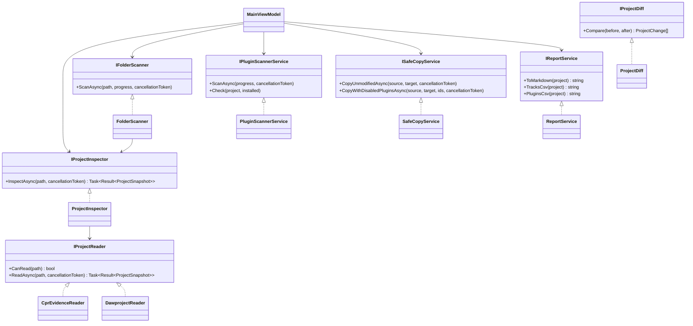

# Architecture and service contracts

## Core service class diagram



## Dependency injection

```csharp
var services = new ServiceCollection()
    .AddCubaseInspector()
    .AddTransient<MainViewModel>()
    .AddTransient<MainWindow>()
    .BuildServiceProvider();
```

`AddCubaseInspector()` registers `CprEvidenceReader` and `DawprojectReader` through `IEnumerable<IProjectReader>`, then singleton inspector, folder scanner, plugin scanner, copy, diff and report services. Immutable result types avoid sharing mutable project state between tasks; cancellation tokens propagate into readers and parallel folder scans. The Uno Desktop app resolves these services from Microsoft DI and binds screens to observable view-models; parsing stays in Core/Infrastructure.

## Data provenance and safe operation

All results distinguish **Confirmed**, **Candidate**, and **Unknown**. `Confirmed` means extracted directly from parsed structure, **not** externally validated Cubase behavior. The CPR reader only emits token offsets as candidate references and never converts them into claimed plugin identities, BPM or tracks.

The binary CPR decoder and editor are not implemented. The only safe write operation is a byte-identical copy to a new path. A future mutating writer must be separately researched, fuzz-tested, and verified by actually opening resulting files in Cubase.

### Plugin validation

`PluginScannerService` finds `.vst3` bundles and potential VST2 `.dll` files under common Windows folders and selected VST registry paths. Reparse points are skipped to avoid recursive loops. Matching a device reference to a filename is reported as **InstalledByName**, not compatibility. Missing entries remain **Unverified**, not definitively absent.

### Threat model

- Untrusted file extensions and arbitrary binaries: guard the entry reader and file sizes.
- ZIP bombs, external entities and malformed XML: ZIP entry and XML character count limits, no DTD resolver.
- Large folders, symlinks and permission errors: bounded BFS and capped parallelism.
- Malicious plugin binaries: never load or execute plugins as part of inspection.
- CSV formula injection: escape formula-prefixed CSV cells.
- Valuable user projects: use `CreateNew`, source stays untouched, and clean partial copies.
